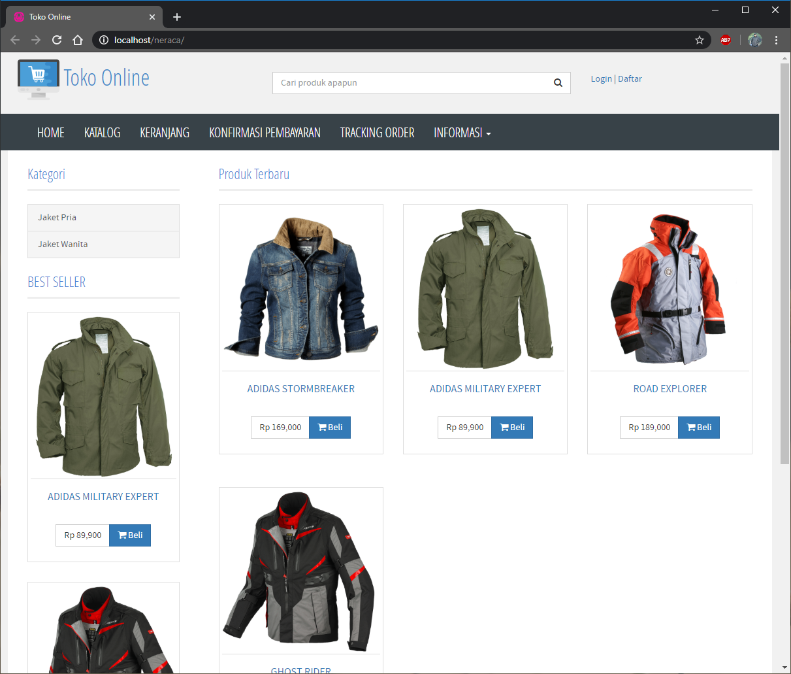
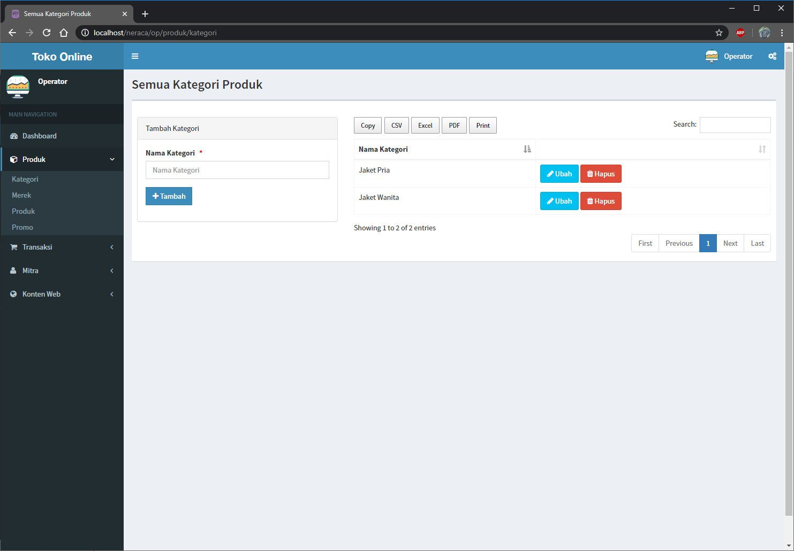
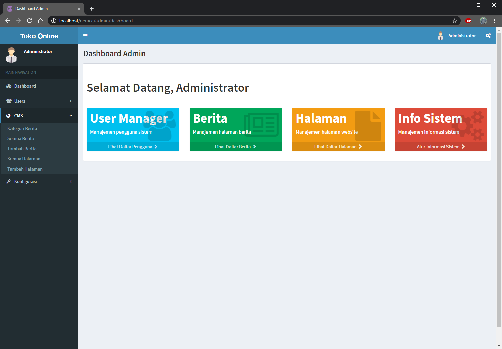

# Toko Online — CodeIgniter 4

Aplikasi toko online sederhana (katalog produk, keranjang, pemesanan, pembayaran, tracking order, CMS, dan multi-role admin) yang dibangun dengan **CodeIgniter 4**, **MySQL**, **Bootstrap 5**, dan **AdminLTE 4**.


---

## Teknologi

| Komponen | Versi |
|---|---|
| CodeIgniter | 4.7.6 |
| PHP | 8.2+ (diuji pada **8.5.12**) |
| Database | MySQL / MariaDB (driver MySQLi) |
| Bootstrap | 5.3.9 |
| AdminLTE | 4.10.2 |
| Font Awesome | 6.7.2 |
| jQuery | 3.7.1 |
| elFinder | 2.1.65 |

---

## Kebutuhan Sistem

- PHP **8.2 atau lebih baru** (disarankan 8.5) dengan ekstensi `mysqli`, `mbstring`, `intl`, `json`, `curl`
- MySQL 5.7+ / MariaDB 10.3+
- Composer
- Web server Apache atau Nginx (Laragon/XAMPP juga bisa)

---

## Instalasi

1. **Ambil dependensi**

   ```bash
   composer install
   ```

2. **Import database**

   Buat database `neracadb`, lalu import file `database.sql`:

   ```bash
   mysql -u root -p neracadb < database.sql
   ```

   Atau lewat phpMyAdmin: *Import* → pilih `database.sql`.

3. **Atur koneksi database**

   Sesuaikan `app/Config/Database.php`:

   ```php
   'hostname' => 'localhost',
   'username' => 'root',
   'password' => '',
   'database' => 'neracadb',
   ```

4. **Atur URL aplikasi**

   Sesuaikan `baseURL` di `app/Config/App.php` dengan alamat yang dipakai:

   ```php
   public string $baseURL = 'https://toko-online-code-igniter.test/';
   public string $indexPage = '';
   ```

5. **Arahkan document root** ke folder project ini (bukan ke `public/`), karena front controller `index.php` berada di root. Pastikan folder `writable/` dapat ditulis oleh web server.

6. **Jalankan**

   - **Laragon/Nginx**: buat virtual host yang mengarah ke folder project, lalu buka `https://toko-online-code-igniter.test`.
   - **Apache**: `.htaccess` sudah tersedia; aktifkan `mod_rewrite` lalu akses folder project.
   - **Server bawaan PHP** (untuk pengembangan):

     ```bash
     php spark serve
     # atau
     php -S 127.0.0.1:8080 index.php
     ```

---

## Akun Default

Gunakan akun berikut untuk masuk ke panel admin melalui halaman **`/login`**:

| Username | Password | Role | Akses Panel |
|---|---|---|---|
| `admin` | `admin` | Administrator | `/admin/dashboard` |
| `op` | `op` | Operator | `/op/dashboard` |

> **Catatan:** akun `bos`, `supplier` (`s1`), dan member (`heru`, `jkt`) juga tersedia di database, dengan password kata yang sama. Password disimpan sebagai hash MD5 di tabel `userlogin`; gunakan fitur reset/ubah password atau perbarui langsung lewat database bila diperlukan.

---

## Cara Menggunakan

### 1. Halaman Toko (Publik)

| Halaman | URL |
|---|---|
| Beranda | `/` |
| Katalog produk | `/katalog` |
| Pencarian produk | `/produk/cari` |
| Keranjang belanja | `/keranjang` |
| Konfirmasi pembayaran | `/konfirmasi` |
| Tracking order | `/tracking` |
| Halaman informasi | `/informasi/{slug}` |

Alur belanja: pilih produk → tambahkan ke keranjang → checkout → lakukan pembayaran → unggah konfirmasi pembayaran → pantau status lewat tracking order.

### 2. Panel Admin

1. Buka `/login`.
2. Masuk dengan **username: `admin`** dan **password: `admin`**.
3. Anda akan diarahkan ke `/admin/dashboard`.

Menu yang tersedia untuk administrator:

- **Users** — daftar pengguna dan tambah pengguna
- **CMS** — kategori berita, berita, dan halaman statis
- **Konfigurasi** — identitas aplikasi, kontak, dan tema

### 3. Panel Operator

Login dengan **`op` / `op`**, lalu kelola dari `/op/dashboard`:

- **Produk** — kategori, merek, produk, promo
- **Transaksi** — order, mutasi stok, permintaan produk
- **Mitra** — supplier, pelanggan, outlet
- **Konten Web** — halaman dan berita

### 4. Akun Member

Pembeli dapat mendaftar dan masuk melalui `/member/login`, lalu melihat profil dan histori belanja di `/akun` dan `/akun/histori`.

### 5. File Manager

Gambar produk dan media lain dapat dikelola melalui elFinder pada `/filemanager/elfinder_init`.

---

## Struktur Folder

```
.
├── app/
│   ├── Compat/          # Lapisan kompatibilitas CodeIgniter 3
│   ├── Config/          # Konfigurasi aplikasi, database, route, session
│   ├── Controllers/     # Controller (Admin, Bos, Op, Supplier, front-end)
│   ├── Helpers/         # Helper lama + helper form gaya CI3
│   ├── Libraries/       # M_database, elFinder, RajaOngkir
│   ├── Models/
│   └── Views/           # View front-end, admin, dan tema
├── assets/              # CSS, JS, gambar, plugin, tema AdminLTE
├── writable/            # Log, cache, session, upload
├── database.sql         # Skema + data awal
├── index.php            # Front controller
└── spark                # CLI CodeIgniter
```

---

## Catatan Pengembangan

- Semua route didefinisikan eksplisit di `app/Config/Routes.php` (`setAutoRoute(false)`).
- Helper `legacy_form_helper.php` menyediakan fungsi form gaya CodeIgniter 3 (`form_open`, `set_value`, `form_error`, dan lainnya).
- Halaman lama yang masih memakai kelas Bootstrap 3 / AdminLTE 2 ditangani oleh `assets/tema/lte/dist/css/legacy.css`, `assets/tema/lte/dist/js/legacy.js`, dan `assets/html/css/legacy-bs3.css`.
- Log aplikasi tersimpan di `writable/logs/`.

---

## Screenshots






---

## Dukungan

Buy me a coffee?
<https://www.paypal.me/candraaditama>
